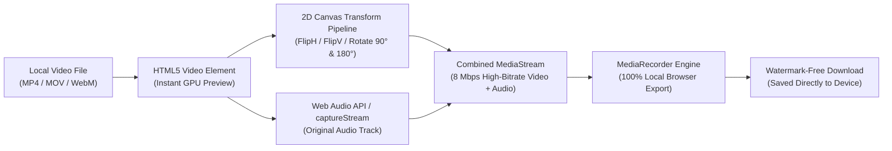

<div align="center">

# FlipVideo — Free Online Video Mirror & Flipper Tool

**Mirror, flip, or rotate MP4, MOV, and WebM videos horizontally and vertically right inside your browser.**  
*100% Client-Side • Zero Server Uploads • Zero Watermarks • Offline-Ready PWA*

[](https://flipvideo.github.io/)
[](https://astro.build/)
[](https://react.dev/)
[](./LICENSE)
[](https://kisharadilshan.gumroad.com/coffee)

[**Launch FlipVideo**](https://flipvideo.github.io/) · [**How to Use Guide**](https://flipvideo.github.io/how-to-use/) · [**Hire the Developer**](https://flipvideo.github.io/hire-me/) · [**Report an Issue**](https://github.com/flipvideo/flipvideo.github.io/issues)

</div>

---

## Overview

**FlipVideo** ([https://flipvideo.github.io/](https://flipvideo.github.io/)) is a privacy-first, high-performance web utility built with **Astro 5**, **React 19**, and **Tailwind CSS**. Unlike cloud-based video editors that require uploading gigabytes of personal video footage to remote servers, FlipVideo executes every horizontal mirror, vertical flip, and 90°/180° orientation transform **100% locally on the user's device**.

Whether you need to fix a backwards front-camera selfie recording so text reads naturally, invert an upside-down action camera clip, or mirror a choreography tutorial for dance practice, FlipVideo previews transitions in real time on the GPU and exports full-resolution video with the original audio track intact.

---

## Core Capabilities

| Capability | Implementation Detail |
| :--- | :--- |
| **100% Client-Side Privacy** | Zero backend servers or cloud storage. Video files are read locally via `URL.createObjectURL` and never leave the browser. |
| **Instant GPU Live Preview** | Hardware-accelerated CSS transform preview (`cubic-bezier(0.22, 1, 0.36, 1)`) for Horizontal Mirror (`scaleX(-1)`), Vertical Flip (`scaleY(-1)`), and 90°/180° Rotations. |
| **Audio-Preserving Local Export** | Pairs 2D Canvas affine matrix rendering (`ctx.translate`, `ctx.rotate`, `ctx.scale`) with `MediaStream` / Web Audio API track capture and high-bitrate `MediaRecorder` encoding. |
| **Built-In Demo Clip Synthesizer** | Includes a one-click **"Try Sample Video"** generator that synthesizes a directional test video in-browser for instant evaluation. |
| **Zero Watermarks & Free Forever** | Exports clean `.mp4` or `.webm` files at native source dimensions without branding overlays, paywalls, or file-size upload queues. |
| **Offline Progressive Web App (PWA)** | Installable via **"Add to Home Screen"** with a cache-first Service Worker (`public/sw.js`) and standalone web manifest (`public/manifest.webmanifest`). |
| **Adaptive Light & Dark Theming** | Pastel Rose & Slate design tokens (`#FFC7C7`, `#FFE2E2`, `#F6F6F6`, `#8785A2`) with an inline anti-FOUC initialization script. |
| **8-Language Internationalization** | Statically pre-rendered routes across 8 global languages with complete `hreflang` and `x-default` cross-linking. |

---

## Client-Side Processing Architecture



---

## Internationalization (i18n) & Multi-Locale Routes

FlipVideo pre-renders 24 static HTML routes across **8 languages** (Home, How to Use, and Hire Me for each locale):

| Locale | Language | Home Route | How to Use Route | Hire Me Route |
| :---: | :--- | :--- | :--- | :--- |
| `en` | **English** (Default) | [`/`](https://flipvideo.github.io/) | [`/how-to-use/`](https://flipvideo.github.io/how-to-use/) | [`/hire-me/`](https://flipvideo.github.io/hire-me/) |
| `es` | **Español** | [`/es/`](https://flipvideo.github.io/es/) | [`/es/how-to-use/`](https://flipvideo.github.io/es/how-to-use/) | [`/es/hire-me/`](https://flipvideo.github.io/es/hire-me/) |
| `pt` | **Português** | [`/pt/`](https://flipvideo.github.io/pt/) | [`/pt/how-to-use/`](https://flipvideo.github.io/pt/how-to-use/) | [`/pt/hire-me/`](https://flipvideo.github.io/pt/hire-me/) |
| `de` | **Deutsch** | [`/de/`](https://flipvideo.github.io/de/) | [`/de/how-to-use/`](https://flipvideo.github.io/de/how-to-use/) | [`/de/hire-me/`](https://flipvideo.github.io/de/hire-me/) |
| `fr` | **Français** | [`/fr/`](https://flipvideo.github.io/fr/) | [`/fr/how-to-use/`](https://flipvideo.github.io/fr/how-to-use/) | [`/fr/hire-me/`](https://flipvideo.github.io/fr/hire-me/) |
| `ja` | **日本語** | [`/ja/`](https://flipvideo.github.io/ja/) | [`/ja/how-to-use/`](https://flipvideo.github.io/ja/how-to-use/) | [`/ja/hire-me/`](https://flipvideo.github.io/ja/hire-me/) |
| `zh` | **简体中文** | [`/zh/`](https://flipvideo.github.io/zh/) | [`/zh/how-to-use/`](https://flipvideo.github.io/zh/how-to-use/) | [`/zh/hire-me/`](https://flipvideo.github.io/zh/hire-me/) |
| `ru` | **Русский** | [`/ru/`](https://flipvideo.github.io/ru/) | [`/ru/how-to-use/`](https://flipvideo.github.io/ru/how-to-use/) | [`/ru/hire-me/`](https://flipvideo.github.io/ru/hire-me/) |

---

## Technical SEO & Accessibility Standards

- **Strict Title & Meta Description Compliance**: Every generated route is validated for Title length (`50–60` characters) and Meta Description length (`130–155` characters).
- **Flat Google Search Console Sitemap**: Custom endpoint at `src/pages/sitemap.xml.ts` outputs a flat `<urlset>` at [`https://flipvideo.github.io/sitemap.xml`](https://flipvideo.github.io/sitemap.xml) with full `xhtml:link` `hreflang` alternates (`en`, `es`, `pt`, `de`, `fr`, `ja`, `zh`, `ru`, and `x-default`).
- **Rich JSON-LD Structured Data**:
  - `WebApplication` + `FAQPage` on Home (`/`) — declares `$0` free utility with zero fake `aggregateRating` spam signals.
  - `BreadcrumbList` + `HowTo` on How to Use (`/how-to-use/`).
  - `BreadcrumbList` + `Person` on Hire Me (`/hire-me/`).
- **WCAG AA+ Accessibility**: Single `<h1>` per route, semantic `<header>`, `<nav>`, `<main>`, `<section>`, `<footer>` landmarks, keyboard-operable dropzone (`role="button"`, `tabindex="0"`), `aria-pressed` states on transform toggles, and `aria-live="polite"` export progress updates.

---

## Repository Structure

```text
flipvideo.github.io/
├── .github/
│   ├── FUNDING.yml                  # GitHub Sponsor button configuration
│   └── workflows/
│       └── deploy.yml               # Official GitHub Pages CI/CD pipeline
├── public/
│   ├── favicon.svg                  # Vector brand icon
│   ├── icon-192.png                 # PWA 192x192 icon
│   ├── icon-512.png                 # PWA 512x512 icon
│   ├── manifest.webmanifest         # Offline PWA Web App Manifest
│   ├── og-image.png                 # Static 1200x630 Open Graph social card
│   ├── robots.txt                   # Crawler directives & Sitemap pointer
│   └── sw.js                        # Cache-first offline Service Worker
├── src/
│   ├── components/
│   │   ├── Breadcrumbs.astro        # Semantic breadcrumb trail + BreadcrumbList JSON-LD
│   │   ├── Footer.astro             # Multi-language footer & copyright
│   │   ├── Navbar.astro             # Minimal top bar + responsive toggle menu
│   │   ├── VideoFlipperIsland.tsx   # React 19 interactive video flipper workspace
│   │   └── pages/
│   │       ├── HireMePage.astro     # Freelance developer profile & one-click copy email
│   │       ├── HomePage.astro       # Full-viewport hero workspace + features + 4 FAQs
│   │       └── HowToUsePage.astro   # Step-by-step instructions & use cases
│   ├── i18n/
│   │   └── translations.ts          # 8-language UI & SEO metadata dictionary
│   ├── layouts/
│   │   └── BaseLayout.astro         # HTML head, anti-FOUC theme script, GTM/GA4, SEO tags
│   ├── pages/
│   │   ├── index.astro              # English Home (/)
│   │   ├── how-to-use/index.astro   # English How to Use (/how-to-use/)
│   │   ├── hire-me/index.astro      # English Hire Me (/hire-me/)
│   │   ├── sitemap.xml.ts           # Flat XML sitemap generator (/sitemap.xml)
│   │   └── [lang]/                  # Localized routes for es, pt, de, fr, ja, zh, ru
│   └── styles/
│       └── global.css               # Tailwind layers & Light/Dark CSS custom properties
├── astro.config.mjs                 # Astro 5 static configuration
├── package.json                     # Scripts & dependencies
├── tailwind.config.mjs              # Brand color tokens & theme mapping
└── tsconfig.json                    # Strict TypeScript configuration
```

---

## Local Development

### Prerequisites

- **Node.js** `>= 20.x` (Node 22 LTS recommended)
- **npm** `>= 10.x`

### Setup & Commands

```bash
# 1. Clone the repository
git clone https://github.com/flipvideo/flipvideo.github.io.git
cd flipvideo.github.io

# 2. Install dependencies
npm install

# 3. Start local development server with hot reload (http://localhost:4321)
npm run dev

# 4. Run production static build into ./dist
npm run build

# 5. Preview the production build locally
npm run preview
```

---

## Publishing to GitHub Pages (GitHub Actions)

Deployment is fully automated via GitHub Actions:

1. **Automated Workflow** ([`.github/workflows/deploy.yml`](./.github/workflows/deploy.yml)): Uses `actions/configure-pages@v5`, `withastro/action@v3`, and `actions/deploy-pages@v4` to build and publish automatically on every push to `main`.
2. **Repository Settings Check**:
   - In your GitHub repository, navigate to **Settings → Pages**.
   - Under **Build and deployment → Source**, select **GitHub Actions**.
   - Push to the `main` branch (`git push origin main`) and your site will be live at **[https://flipvideo.github.io/](https://flipvideo.github.io/)**.

---

## Author & Freelance Inquiries

Designed and engineered by **Kishara Dilshan** — Full-Stack Web & Client-Side WebAssembly Developer.

- **Hire Me for Custom Web & WASM Projects**: [https://flipvideo.github.io/hire-me/](https://flipvideo.github.io/hire-me/)
- **Direct Email**: [`kisharadilshan007@gmail.com`](mailto:kisharadilshan007@gmail.com)
- **Support My Open-Source Tools**: [Buy Me a Coffee on Gumroad](https://kisharadilshan.gumroad.com/coffee)

---

## License

Distributed under the **[MIT License](./LICENSE)**. Copyright © 2026 **Kishara Dilshan**.
